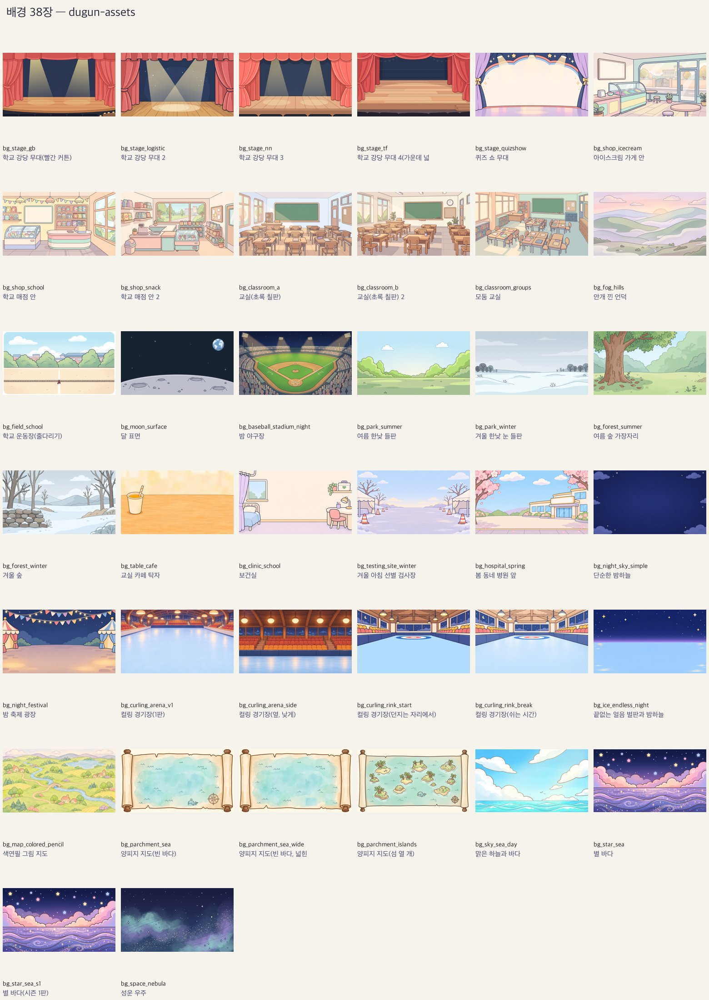
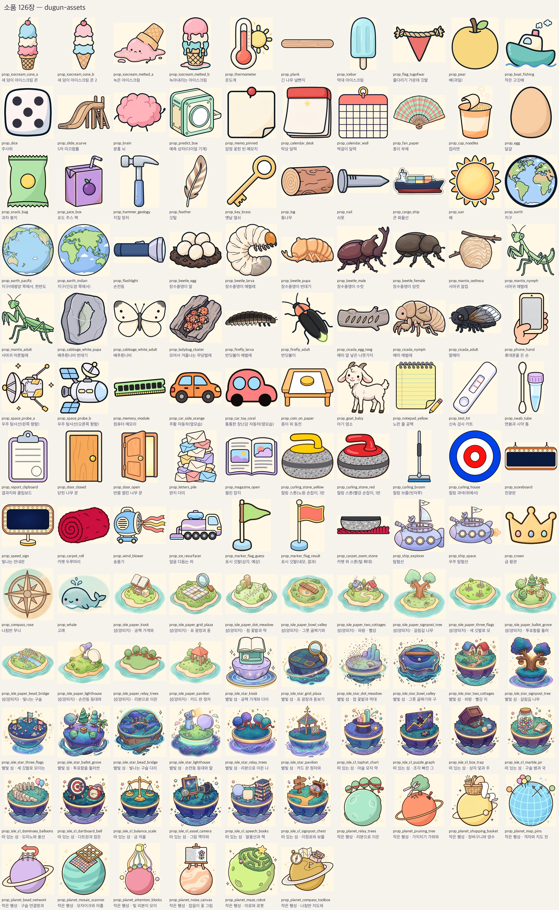
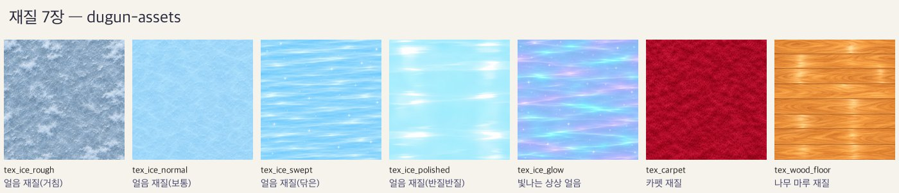

# dugun-assets — 두근두근러닝 그림 모음

**갤러리(그림 보고 바로 내려받기): https://greatsong.github.io/dugun-assets/**

**두근두근러닝**은 캐릭터가 연기로 개념을 설명하는 데이터 · AI · 과학 수업 영상 시리즈입니다.
이 저장소에는 영상을 만들면서 그린 **배경 · 소품 · 재질 · 효과 · 캐릭터 · 아이콘 213장**을 모아 두었습니다.
수업 자료, 발표, 학습지, 교육용 영상에 **비상업적 목적이라면 출처를 밝히고 자유롭게** 쓸 수 있습니다.

## 어떤 그림이 있나요?
| 종류 | 폴더 | 장 수 | 미리보기 |
|---|---|---|---|
| 배경 | `backgrounds/` | 38 | `sheets/backgrounds.jpg` |
| 소품 | `props/` | 126 | `sheets/props.jpg` |
| 재질 | `textures/` | 7 | `sheets/textures.jpg` |
| 효과 | `effects/` | 4 | `sheets/effects.jpg` |
| 캐릭터 | `characters/` | 26 | `sheets/characters.jpg` |
| 아이콘 | `icons/` | 12 | `sheets/icons.jpg` |

### 캐릭터


### 배경


### 소품


### 재질 · 효과 · 아이콘



같은 대상을 여러 버전으로 그린 그림(무대 5가지, 교실 3가지 등)은 `sheets/_variants.jpg`에 모아 두었습니다.

## 목록 `catalog.json`
그림 하나마다 정보가 한 항목씩 들어 있습니다.

| 항목 | 설명 |
|---|---|
| `id` · `file` | 고유 이름(ID)과 파일 경로 (`bg_` 배경, `prop_` 소품, `tex_` 재질, `fx_` 효과, `char_` 캐릭터, `icon_` 아이콘) |
| `kind` · `title` · `tags` | 종류, 우리말 제목, 검색어(태그) |
| `prompt` | 그림을 생성할 때 입력한 프롬프트 전문. 남아 있지 않으면 "기록 없음" |
| `tool` | 생성 도구. 기록이 확실한 것과 "추정: …"을 구분해 적었습니다 |
| `made` · `from_topic` · `used_in` | 만든 날(파일 시각), 처음 그린 영상, 쓰인 영상 |
| `size` · `sha1` | 가로 · 세로 크기와 파일 용량(바이트), 파일 해시값(SHA-1) |
| `aliases` | 원래 제작 폴더에서 쓰던 이름 |
| `variant_of` | 같은 대상을 여러 버전으로 그린 묶음의 이름 |
| `note` | 참고 사항 |

## 쓰는 법
그림 파일을 바로 내려받아 써도 됩니다. 파이썬(Python)과 Pillow가 설치되어 있다면 스크립트로 쉽게 찾고 복사할 수 있습니다.

```bash
python3 tools/find.py 교실 칠판          # 낱말로 찾기 → 후보 표 + 임시 미리보기 시트
python3 tools/find.py 얼음 --kind 배경
python3 tools/use.py bg_classroom_a --to ./내_자료/   # 원하는 폴더로 복사
python3 tools/sheets.py                   # 미리보기 시트 새로 만들기
```
`tools/add.py`는 두근두근러닝 제작 폴더에서 새 그림을 이 저장소에 넣을 때 쓰는 도구입니다.
그림을 더한 뒤에는 갤러리용 미리보기와 표를 다시 만듭니다: `python3 tools/thumbs.py && python3 tools/to_csv.py && python3 tools/sheets.py`

## 갤러리
`index.html`(+ `gallery.css` · `gallery.js`)이 `catalog.json`을 읽어 그림을 보여 줍니다. 미리보기는 `thumbs/`(긴 변 480px webp), 원본은 누를 때만 받습니다.
그리드 / 문서(표) 보기, 여러 장 골라 ZIP으로 받기, 종류별 ZIP, 목록 CSV · JSON 받기가 됩니다. 전체 ZIP은 GitHub의 저장소 ZIP 주소로 받습니다.
ZIP 묶기에는 JSZip 3.10.1(`vendor/`, MIT 라이선스 — `vendor/JSZIP_LICENSE.markdown`)을 씁니다.

## 출처 표시
쓸 때 아래처럼 밝혀 주세요.

> 그림: 두근두근러닝(greatsong), CC BY-NC 4.0 — https://github.com/greatsong/dugun-assets

## 라이선스
[CC BY-NC 4.0](https://creativecommons.org/licenses/by-nc/4.0/deed.ko) (저작자 표시 · 비영리). 자세한 내용은 `LICENSE`를 보세요.
- 출처를 밝히면 자유롭게 복사 · 배포 · 수정할 수 있습니다.
- 상업적 목적으로는 쓸 수 없습니다.

## AI 그림 도구로 만들었습니다
이 그림들은 **AI 그림 도구(Gemini · OpenAI · Codex 등)로 만든 뒤 사람이 고르고 손본 것**입니다.
- 어느 도구로 그렸는지는 `catalog.json`의 `tool` 칸에 적었습니다. 오래된 그림은 기록이 부족해 "추정"이라고 밝혔습니다.
- 같은 AI 도구를 쓰면 다른 사람에게도 비슷한 그림이 나올 수 있습니다.
- Google 도구로 만든 그림에는 눈에 보이지 않는 SynthID 워터마크가 들어 있을 수 있습니다.
- 지구 그림 3장은 실제 대륙 모양을, 곤충 그림 16장은 한국에 사는 실제 종을 바탕으로 그렸습니다. 다만 도감처럼 정확한 그림은 아닙니다.

## 더 그리고 싶다면
같은 그림체로 더 그리는 방법은 `STYLE.md`(그림체 기준과 프롬프트 틀)에 있습니다.
