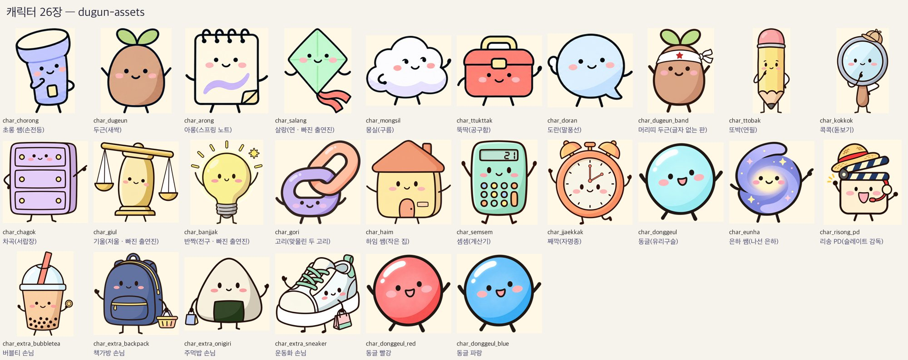
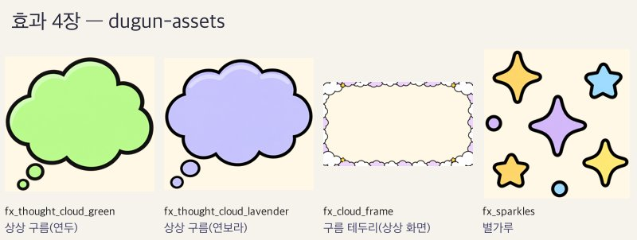
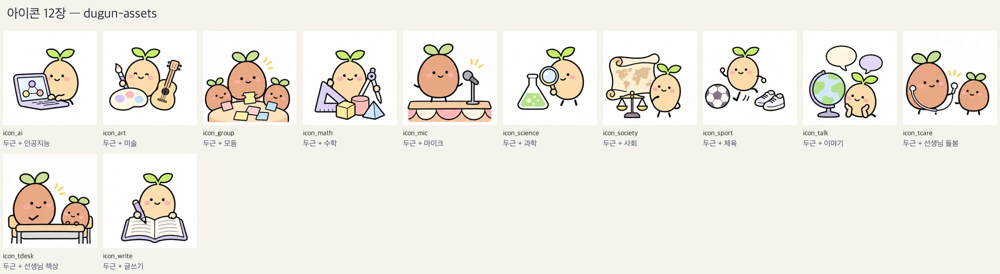

# dugun-assets — 두근두근러닝 그림 모음

**갤러리(그림 보고 바로 내려받기): https://greatsong.github.io/dugun-assets/**

**두근두근러닝**은 캐릭터가 연기로 개념을 설명하는 데이터 · AI · 과학 수업 영상 시리즈입니다.
이 저장소에는 영상을 만들면서 그린 **배경 · 소품 · 재질 · 효과 · 캐릭터 · 아이콘 213장**과, 코드로 직접 만든 **음악 42곡(게임 음악 14곡 · 늘린 판 10곡 포함, 그중 30곡은 끊김 없이 되풀이하는 반복용 버전이 있음) · 효과음 50가지**(소리 파일 462개)를 모아 두었습니다.
수업 자료, 발표, 학습지, 교육용 영상에 **비상업적 목적이라면 출처를 밝히고 자유롭게** 쓸 수 있습니다.

## 어떤 그림이 있나요?
| 종류 | 폴더 | 장 수 | 미리보기 |
|---|---|---|---|
| 배경 | `backgrounds/` | 38 | `sheets/backgrounds.jpg` |
| 소품 | `props/` | 126 | `sheets/props.jpg` |
| 재질 | `textures/` | 7 | `sheets/textures.jpg` |
| 효과 | `effects/` | 4 | `sheets/effects.jpg` |
| 캐릭터 | `characters/` | 26 | `sheets/characters.jpg` |
| 아이콘 | `icons/` | 12 | `sheets/icons.jpg` |
| 음악 | `audio/music/`, `audio/music/game/`, `audio/music/long/` | 42곡 | 갤러리에서 바로 듣기 |
| 효과음 | `audio/sfx/`, `audio/music/game/` | 50가지 | 갤러리에서 바로 듣기 |

### 캐릭터


### 배경


### 소품


### 재질 · 효과 · 아이콘




같은 대상을 여러 버전으로 그린 그림(무대 5가지, 교실 3가지 등)은 `sheets/_variants.jpg`에 모아 두었습니다.

## 음악 · 효과음 `audio/`
외부 음원이나 샘플 없이 **파이썬(numpy) 코드로 직접 합성**했습니다. 파일마다 **m4a(AAC 192 kbps)와 mp3(192 kbps)** 두 가지가 있습니다.
- 끝 화면 음악 A~I(15초): 영상 끝에서 다음 편을 추천하는 화면에 쓰는 곡. 편마다 반짝 소리 자리만 다른 판이 있어, 대표 판 하나씩 넣었습니다.
- 배경 음악 '건반' A1 · A2 · B1 · B2(48초 + 꼬리 4초): 대사 밑에 작게 까는 곡. 48초마다 겹쳐 이어 붙이면 끊김이 없습니다.
- 극장판 「모델이란 무엇인가」 음악 5 · 효과음 12: 제작 중인 편의 **후보**입니다(`status: "후보"`).
- **반복용 판**(`music_*_loop`, 태그 `반복용`, `loop: true`): 이어 붙여 끝없이 되풀이해도 이음매가 들리지 않게 맞춘 사본입니다. 건반 A1 · A2 · B1 · B2와 「촛불 서재」 · 「별 헤는 밤」 · 「옛 시계 공방」. 파일을 두 번 이어 붙여 이음매 앞뒤 0.2초 음량 차와 파형 튐을 재서, 곡 안의 마디 경계와 같은 수준인 것만 넣었습니다(잰 값은 `loop_note`). 원곡은 그대로 두었습니다.
- **늘린 판 10곡**(`audio/music/long/`, `source_ids`가 원래 곡): 끝 화면 음악 A~I와 건반 배경 음악을 같은 동기 · 화음 · 악기로 늘려 15초 · 30초 · 60초 · 전체 · 반복용 버전을 만들었습니다(피치카토 발걸음은 반복용 버전 없이 네 버전). 늘리며 새로 쓴 선율은 다른 AI 둘에게 닮음 검사를 받았습니다. 만든 코드는 아직 저장소에 사본이 없습니다.
- **게임 음악 20곡**(`style: "게임"`, `audio/music/game/`): 되풀이 곡 14곡은 15초 · 30초 · 전체(끝맺음 있음) · 반복용(끝없이 되풀이) 네 버전, 짧은 신호음 6개(판 깼다 · 별 획득 · 정답 · 아쉬워요 · 레벨 업 · 저장 종). 널리 알려진 곡과 닮았는지 다른 AI 둘에게 검사받았습니다(AI 기억에 기댄 1차 거르기). 만든 코드는 아직 저장소에 사본이 없습니다.
- **교실 · 예능 효과음 32가지**(`style: "교실"`/`"예능"`): 퀴즈 생각 시간 · 정답 딩동 · 띠용 · 두둥 · 박수 등. 같은 효과음을 1 · 2 · 3번 버전으로 만들어 한 항목의 `versions`에 담았습니다. 대사 위에 얹을 때 줄일 크기는 `mix_db`.
- 만든 코드: `tools/sound/`(설명은 `tools/sound/README.md`).
- 목록에서 소리 항목은 그림의 `prompt` · `size.w/h` 대신 `length`(초) · `tempo` · `key` · `made_by`(만든 법) · `status`(쓰임/후보) · `used_in`(쓰인 영상) · `situation`(상황) · `mood`(분위기) · `loop`(이어 붙여 끝없이 되풀이해도 매끄러운지) · `files`(m4a · mp3)를 씁니다.
- 한 곡에 길이별 판(15초 · 30초 · 60초 · 전체 · 반복용)이나 1 · 2 · 3번 버전이 있으면 `versions: [{label, id, file, files, length}, …]`에 담고, 갤러리 카드에서 칩으로 골라 듣고 받습니다. 반복용 판은 `loop_of`(원곡 id) · 원곡의 `loop_version`으로 서로 이어집니다.

## 목록 `catalog.json`
그림 하나마다 정보가 한 항목씩 들어 있습니다.

| 항목 | 설명 |
|---|---|
| `id` · `file` | 고유 이름(ID)과 파일 경로 (`bg_` 배경, `prop_` 소품, `tex_` 재질, `fx_` 효과, `char_` 캐릭터, `icon_` 아이콘) |
| `kind` · `title` · `tags` | 종류, 우리말 제목, 검색어(태그) |
| `prompt` | 그림을 생성할 때 입력한 프롬프트 전문. 남아 있지 않으면 "기록 없음" |
| `tool` | 생성 도구. 기록이 확실한 것과 "추정: …"을 구분해 적었습니다 |
| `made` · `from_topic` · `used_in` | 만든 날(파일 시각), 처음 그린 영상, 쓰인 영상 |
| `size` · `sha1` | 가로 · 세로 크기와 파일 용량(바이트), 파일 해시값(SHA-1) |
| `aliases` | 원래 제작 폴더에서 쓰던 이름 |
| `variant_of` | 같은 대상을 여러 버전으로 그린 묶음의 이름 |
| `note` | 참고 사항 |

## 쓰는 법
그림 파일을 바로 내려받아 써도 됩니다. 파이썬(Python)과 Pillow가 설치되어 있다면 스크립트로 쉽게 찾고 복사할 수 있습니다.

```bash
python3 tools/find.py 교실 칠판          # 낱말로 찾기 → 후보 표 + 임시 미리보기 시트
python3 tools/find.py 얼음 --kind 배경
python3 tools/use.py bg_classroom_a --to ./내_자료/   # 원하는 폴더로 복사
python3 tools/sheets.py                   # 미리보기 시트 새로 만들기
```
`tools/add.py`는 두근두근러닝 제작 폴더에서 새 그림을 이 저장소에 넣을 때 쓰는 도구입니다.
그림을 더한 뒤에는 갤러리용 미리보기와 표를 다시 만듭니다: `python3 tools/thumbs.py && python3 tools/to_csv.py && python3 tools/sheets.py`

## 갤러리
`index.html`(+ `gallery.css` · `gallery.js`)이 `catalog.json`을 읽어 그림을 보여 줍니다. 미리보기는 `thumbs/`(긴 변 480px webp, 투명 배경은 투명한 채로), 소리 파형 막대는 `audio/waves.json`, 원본은 누를 때만 받습니다.
그리드 / 문서(표) 보기, 음악 · 효과음 바로 듣기(▶ — 길이 · 버전 칩으로 골라 듣기, 반복용은 멈출 때까지 끊김 없이 되풀이), 반복용 · 교실 · 예능으로 거르기, 여러 개 골라 ZIP으로 받기, 종류별 ZIP, 목록 CSV · JSON 받기가 됩니다. 전체 ZIP은 GitHub의 저장소 ZIP 주소로 받습니다.
ZIP 묶기에는 JSZip 3.10.1(`vendor/`, MIT 라이선스 — `vendor/JSZIP_LICENSE.markdown`)을 씁니다.

## 출처 표시
쓸 때 아래처럼 밝혀 주세요.

> 그림(또는 음악 · 효과음): 두근두근러닝(greatsong), CC BY-NC 4.0 — https://github.com/greatsong/dugun-assets

## 라이선스
[CC BY-NC 4.0](https://creativecommons.org/licenses/by-nc/4.0/deed.ko) (저작자 표시 · 비영리). 자세한 내용은 `LICENSE`를 보세요.
- 출처를 밝히면 자유롭게 복사 · 배포 · 수정할 수 있습니다.
- 상업적 목적으로는 쓸 수 없습니다.

## AI 그림 도구로 만들었습니다
이 그림들은 **AI 그림 도구(Gemini · OpenAI · Codex 등)로 만든 뒤 사람이 고르고 손본 것**입니다.
- 어느 도구로 그렸는지는 `catalog.json`의 `tool` 칸에 적었습니다. 오래된 그림은 기록이 부족해 "추정"이라고 밝혔습니다.
- 같은 AI 도구를 쓰면 다른 사람에게도 비슷한 그림이 나올 수 있습니다.
- Google 도구로 만든 그림에는 눈에 보이지 않는 SynthID 워터마크가 들어 있을 수 있습니다.
- 지구 그림 3장은 실제 대륙 모양을, 곤충 그림 16장은 한국에 사는 실제 종을 바탕으로 그렸습니다. 다만 도감처럼 정확한 그림은 아닙니다.

## 더 그리고 싶다면
같은 그림체로 더 그리는 방법은 `STYLE.md`(그림체 기준과 프롬프트 틀)에 있습니다.
